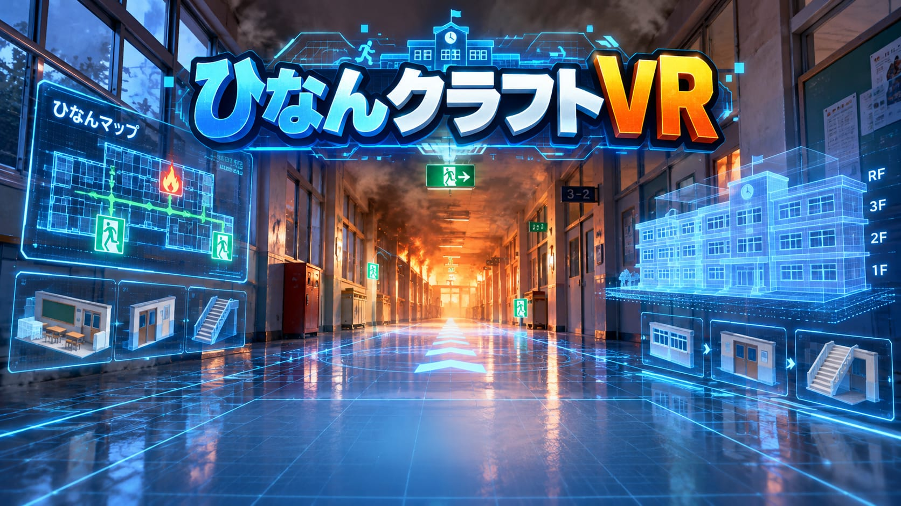
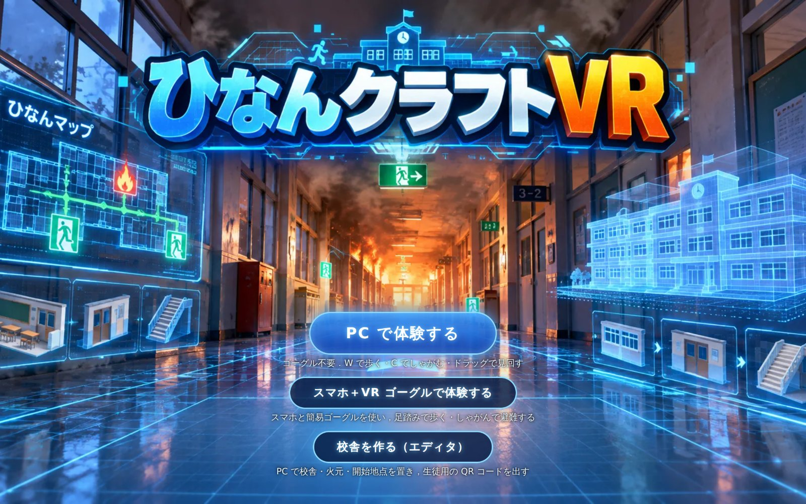
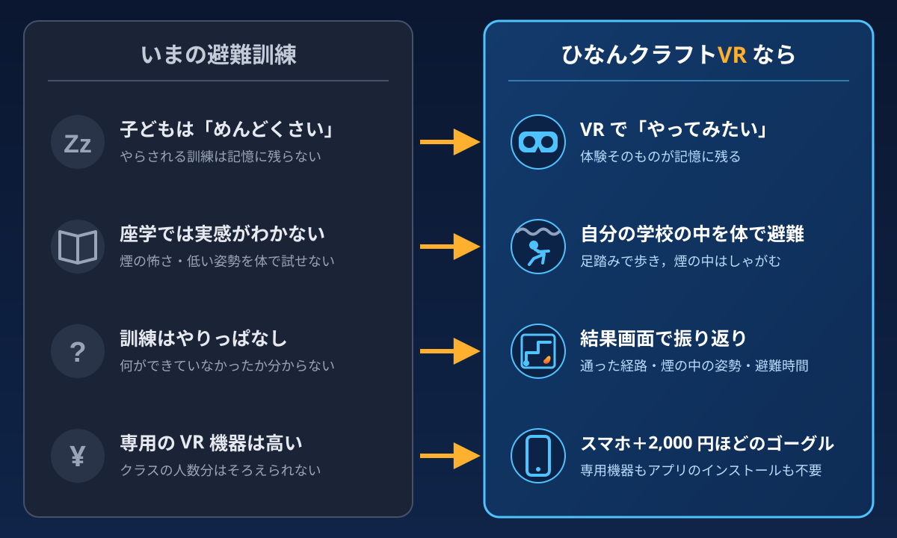
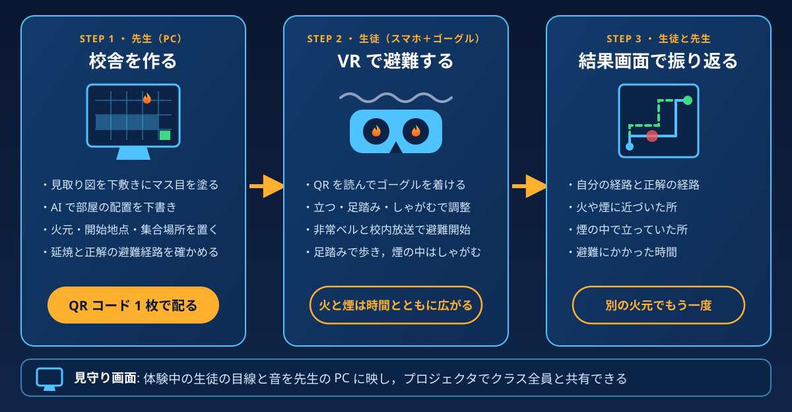
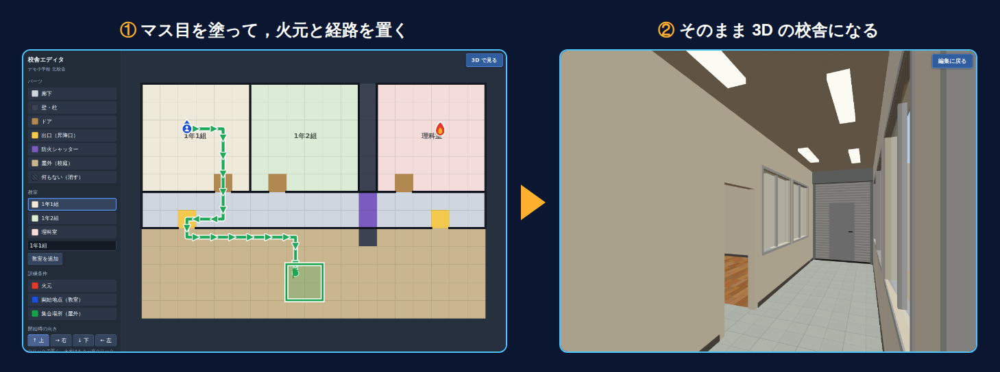
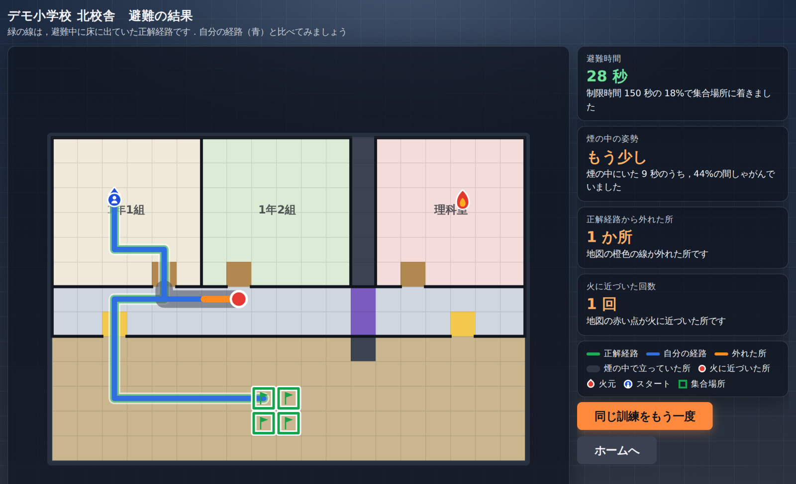
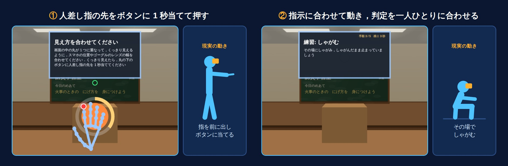

# ひなんクラフトVR

<!-- TODO: デモ動画を YouTube 等に上げたら，下のリンク先（# の部分）を動画の URL に差し替える -->
[](#)

**スマホと 2,000 円ほどのゴーグルで，自分の学校の校舎を舞台に火災避難訓練を体験できる，学校向けの Web の VR シミュレーター**

- 体験する（トップ画面．「PC で体験する」「スマホ＋VR ゴーグルで体験する」「校舎を作る（エディタ）」の 3 つの入口がある）: <https://tkb2608.pages.dev>
- 生徒の体験だけを試す（同梱のデモの校舎）: <https://tkb2608.pages.dev/?app>（スマホで開き，簡易 VR ゴーグルに入れる）
- 見守り画面（PC）: エディタの「見守り画面を開く」から開く



## 製品概要

### 背景(製品開発のきっかけ、課題等）



小学校の避難訓練は，毎年ほぼ同じ火元・同じ経路で行われ，「放送どおりに並んで歩く」ことが中心になりがちです．
しかし本当の火災では，「いつもの階段が火で使えない」「廊下が煙で見えない」といったことが起こります．火元によって逃げ道が変わることや，煙の中では姿勢を低くすることを，訓練で自分の体を使って試す機会はほとんどありません．

そのうえ，**子どもたちにとって避難訓練は「めんどくさい行事」**になりがちです．毎年同じ流れをなぞるだけなので，真剣に取り組む理由が見つからず，訓練の中身も記憶に残りません．教室で防災の話を聞く座学も，実際に火や煙に囲まれた場面を想像するのは難しく，「知っている」が「いざという時に体が動く」につながりにくいのが課題です．

VR で火災を体験できる教材はすでにありますが，多くは専用の VR 機器が要り，舞台も「どこかの建物」です．子どもが実際に逃げるのは**自分の学校の校舎**であり，学校に高価な機器をクラスの人数分そろえるのも難しいのが現状です．

そこで私たちは，**学校が無理なく導入できる値段で，子どもが「やってみたい」と思える避難訓練**を作ることにしました．

### 製品説明（具体的な製品の説明）

ひなんクラフトVR は，先生が PC で自分の学校の校舎を作り，生徒がスマホと簡易 VR ゴーグルでその校舎の中を避難する Web アプリです．



火と煙は時間とともにマス目の上を広がり，防火シャッターで止まります．煙の中で立ったままでいたり火に近づいたりすると，その間だけ VR の画面が赤くなり，誤った行動がその場で分かります．
先生の PC には，体験中の生徒の目線と音をリアルタイムに映す見守り画面があり，プロジェクタでクラス全員と体験を共有できます．

### 特長

#### 1. 先生が 1 人で「自分の学校」を作れる



3D の知識は要りません．見取り図の写真を下敷きにしてマス目にパーツを塗るだけで，壁・ドア・シャッターは隣のマスとの関係から自動で置かれ，3D の校舎が組み上がります．見取り図の写真を生成 AI（Gemini）に読ませて部屋の配置の下書きを作ることもできます．火元を置けば延焼の広がりと「火と煙を避けた最短の避難経路」が自動で出るので，先生は学校の決まり（使う出口など）に合わせて直すだけです．

#### 2. コントローラーなしで「歩く・しゃがむ」を体で覚える

スマホの加速度センサーで，その場の足踏みを前進に，しゃがむ動きを低い姿勢に変えます．煙は天井近くほど濃く，しゃがむと視界が晴れます．煙の中で立ち上がると画面が赤くなるので，「煙の中では姿勢を低く」を体で覚えられます．ゴーグルにボタンが無くても，背面カメラで手を認識し，人差し指の先でボタンに触れて訓練を始められます．

#### 3. スマホと 2,000 円ほどのゴーグルだけで学校に入る

生徒が使うのは，手持ちのスマートフォンと，スマホを差し込むだけの簡易 VR ゴーグルです．動作を確かめた ELECOM VRG-S01BK は，税込 1,500〜2,400 円ほどで市販されています（2026 年 10 月時点．[ツクモ](https://shop.tsukumo.co.jp/goods/4549550119627/)・[ケーズデンキ](https://www.ksdenki.com/shop/g/g4549550119627/)）．数万円以上する専用の VR 機器と比べて，学校の予算でも数をそろえやすい値段です．
専用の VR 機器・アプリのインストール・ログインは要りません．校舎のデータは圧縮して URL に埋め込み，QR コードで配るため，校舎や生徒のデータを保存するサーバーもありません．体験は通信が無くても最後まで動き，見守りの中継は届いたものを流すだけで何も保存しません．

### 解決出来ること



- **生徒が訓練に興味を持てない**: VR で自分の学校の中を逃げるという体験そのものが，子どもにとって「やってみたい」と思えるものになる．ゲームのように体を動かして進むので，受け身ではなく自分から参加できる
- **訓練の内容が記憶に残らない**: VR の体験自体が印象に残る出来事になり，その記憶と結びついて「どの道で逃げたか」「煙の中でしゃがんだ」といった避難の仕方も思い出しやすくなると期待できる
- **座学では実感がわかない**: 火と煙が広がる校舎の中を自分の体で進むので，話を聞くだけの座学より臨場感があり，学んだことが身につきやすいと期待できる
- **訓練の形骸化**: 火元を変えるたびに延焼と正しい逃げ道が変わるので，「いつもの経路が使えない」状況を何度でも練習できる
- **煙の怖さ・正しい姿勢を体験できない**: 煙の中を実際にしゃがんで進み，立つとその場で赤く警告される
- **振り返りができない**: 結果画面で，自分の経路と正解経路の違い・火や煙に近づいた所・煙の中で立っていた所・避難にかかった秒数を地図で確かめられる
- **導入の壁**: 必要なのはスマホと 2,000 円ほどの簡易ゴーグル，先生の PC だけ．費用も準備の手間も小さく，教育機関が予算の範囲で取り入れられる

### 今後の展望

- 複数フロア（階段）の校舎と，教室ごとに別の QR コード（クラス単位の訓練）
- 見守り画面で複数の生徒を同時に見る（地図の上の点と名前，選び直し）
- 地震など火災以外の災害への展開（地震の体験は開発の初期に試作済み）
- 消火器・防火扉のくぐり戸など，手を使った行動の追加
- 実際の学校での試用と，訓練の効果の検証

### 注力したこと（こだわり等）



- **スマホのセンサーだけで足踏みとしゃがみを判定**: 加速度に帯域通過フィルタとシュミットトリガをかけて 1 歩を数え，頭を速く回した時の揺れは歩数に入れない．しゃがみは短い区間だけ加速度を 2 回積分し，静止の検出（ZUPT）で積分の誤差を打ち切る．チーム 4 人分の「正解付きの動きの記録」を取り，再生して判定を調整する仕組みを作ってから合わせ込んだ
- **一人ひとりに合わせるキャリブレーション**: ゴーグルを着けた後に数秒ずつ「立って静止・足踏み・しゃがむ・しゃがみ歩き」をしてもらい，その人の歩き方・しゃがむ深さから判定のしきい値を求め直す．場所は VR の中の「防災学習室」で，まず左右の目の中心に印を出してスマホの位置とレンズの幅を合わせてもらう．各手順は「指示の読み上げ → 3・2・1 の合図 → 計測」の順で進み，子どもが説明なしで最後まで進める．読み上げが終わった知らせが端末から届かなくても「1 秒 7 文字＋4 秒」の見積もりで必ず先へ進み，測れなかった値は既定値のまま使うので，途中で止まらない
- **ハンドトラッキングで VR の中のボタンを押す**: ボタンもコントローラーも無いゴーグルのため，スマホの背面カメラで手を認識し（MediaPipe の 21 点），人差し指の先でボタンに触れて押す．指先がボタンから 12 cm 以内に 1 秒入ると押した扱いにし，ボタンが出た直後は数えないので，前の画面で上げていた手で誤って押さない．認識の中身にも手を入れた
  - MediaPipe が返す左右の判定は認識のたびに揺れるため使わず，前回の手の位置から左右を振り分ける
  - One Euro フィルタで止めた手の震えを抑え，次の認識までの間は位置を先読みして遅れを隠す
  - 背面カメラは VR の視界より画角が狭いため，手の位置を横 1.2 倍・縦 1.4 倍に広げて視界の端のボタンまで届かせる
  - 手が 10 秒見えない時は「手を目の前に出して」と案内し，30 秒見えない時は先へ進めて，子どもが詰まらないようにする
- **時間で変わる延焼を見た正解経路**: 火と煙が各マスに着く時刻を求め，「そのマスに着いた時に燃えていないか」を見て，煙と火の側をなるべく避けた最短経路を提案する．エディタでは時刻のスライダーで広がり方をプレビューできる
- **iPhone の Safari で動く VR**: iPhone の Safari は WebXR に対応していないため，左右 2 画面の描画と頭の向きの追従を自前で行った．手の認識は Web Worker で動かし，描画を止めない
- **QR コード 1 枚に校舎を載せる**: 校舎のマス目を 1 マス 1 文字の JSON にし，deflate で圧縮して base64url で URL に埋め込む．細工したデータで端末のメモリを使い切らないよう，展開する大きさに上限を設けて検査する
- **授業で使える見守り**: 映像は送らず，位置・頭の向き・姿勢などの小さな状態（1 回 20 バイトほど）だけを中継し，PC 側で同じ校舎と目線を描き直す．効果音やナレーションも「どの音を鳴らすか」の合図だけを送って PC から鳴らす．届いた状態は約 100 ms 遅らせて前後の 2 つの間を補間し，通信の揺らぎがあっても目線がなめらかに動くようにした．火と煙は届いた時刻から PC 側で計算し直すので，生徒と同じ見た目になる．避難が終わると経路の記録を 1 件 10 バイトに詰めて送り，PC 側でも生徒と同じ結果画面を出す
- **VR 酔いを防ぎ，子どもが安全に使える端末の扱い**: 歩く速さはバネのように目標へ追わせ，急な加速・減速を抑える．煙の中で立った時の赤い表示は点滅させず，短いフェードだけにする．頭の向きはジャイロの角速度で 30 ms 先を読んで表示の遅れを隠す（ゆっくり回す時は先読みしない）．体験中は画面が消えないようにし（Screen Wake Lock），スマホが縦向きや逆さまの時は案内を出す
- **iPhone で左右 2 画面を描いても重くしない工夫**: 校舎の動かない部品はマテリアルごとに 1 つに結合し，描画の回数をマテリアルの数ほどに減らす．炎の粒（600 個）や床の矢印はまとめて 1 回で描き，煙は視線に垂直な板を重ねて描く．手の認識は映像を縮小してから Web Worker に渡し，描画が重くなったら認識の回数を 15 → 10 → 7 回/秒と下げて，VR の描画を優先する

## 開発技術

### 活用した技術

#### API・データ

- Gemini API（見取り図の写真から部屋の配置の下書きを作る．構造化出力で部屋の矩形を受け取る）
- Web API: DeviceOrientationEvent・DeviceMotionEvent（頭の向き・足踏み・しゃがみ），getUserMedia（背面カメラ），Web Speech API の speechSynthesis（校内放送・案内のナレーションを端末の日本語の声で読み上げる），Web Audio API（非常ベル・チャイム・警告音などの効果音をその場で合成する．音声ファイルは持たない），CompressionStream（URL への圧縮）

#### フレームワーク・ライブラリ・モジュール

- TypeScript / Vite
- three.js（3D の校舎・火と煙・左右 2 画面の描画）
- MediaPipe Tasks Vision（HandLandmarker．手の 21 点の認識）
- qrcode-generator（QR コードの生成）
- Cloudflare Pages（静的サイトの配信）・Pages Functions（Gemini を呼ぶサーバー関数）
- Cloudflare Workers + Durable Objects（見守りの WebSocket の中継．何も保存しない）
- Vitest（単体テスト）・Biome（lint・整形）

#### デバイス

- スマートフォン（iPhone の Safari を最優先．Android の Chrome でも動く）
- 簡易 VR ゴーグル（ELECOM VRG-S01BK．ボタン・コントローラーなし）
- PC のブラウザ（校舎エディタ・見守り画面）

### 独自技術

#### ハッカソンで開発した独自機能・技術

プロダクトのコードは，すべて Hack Day（2026-10-24 10:20 以降）に書きました．大会前に用意したのは開発環境（`.claude/`・`docs/` のルール類）だけです．

- **延焼・正解経路・評価の計算**（[src/sim/](src/sim/)．[spread.ts](src/sim/spread.ts)・[route.ts](src/sim/route.ts)・[evaluate.ts](src/sim/evaluate.ts)・[walls.ts](src/sim/walls.ts)．commit `d969fd0`）
- **足踏み・しゃがみの判定**（[stepDetector.ts](src/input/body/stepDetector.ts)・[posture.ts](src/input/body/posture.ts)．commit `7d5c6b2`，記録 4 人分での調整 `ea83714`）と**動きの記録・再生・回帰テストの仕組み**（[src/input/replay/](src/input/replay/)・[scripts/replay.mjs](scripts/replay.mjs)．commit `c7a3006`・`e95efd0`）
- **キャリブレーションからのしきい値の算出**（[calibration.ts](src/input/body/calibration.ts)．commit `bd3bd32`）
- **校舎エディタ**（[src/editor/](src/editor/)．マス目の編集 `17642c4`，写真の下敷き `4487cc1`，延焼のプレビュー `4be6104`，正解経路の提案と修正 `0ebfb48`，3D で確かめる view モード `13dd4fc`）
- **見取り図から AI で下書き**（[functions/api/floor-draft.ts](functions/api/floor-draft.ts)・[draftFromBoxes.ts](src/editor/draftFromBoxes.ts)．commit `8fdf1df`）
- **マス目からの 3D の校舎の組み立てと火・煙の描画**（[src/scenes/school/](src/scenes/school/)．commit `2704728`・`94ed736`・`80cbf97`）
- **校舎データの URL への埋め込み**（[planCodec.ts](src/share/planCodec.ts)・[validatePlan.ts](src/share/validatePlan.ts)．commit `6d1c62b`）
- **背面カメラによる手の認識**（[src/input/hand/](src/input/hand/)．commit `9b3207b`・`cc44fb0`）
- **結果画面**（[src/debrief/](src/debrief/)．commit `5bb2181`）
- **見守りの中継と見守り画面**（[relay/src/index.ts](relay/src/index.ts)・[src/monitor/](src/monitor/)．commit `bbfe9eb`・`f361779`・`2ee0f71`・`0c07ceb`）
- **火災訓練を最初から結果画面まで通す体験の流れ**（[src/app/](src/app/)．commit `b529374`）

判定・計算のロジックは描画やブラウザ API から切り離した純粋な関数にし，200 を超えるテストファイルで確かめています．

## 動かし方（開発者向け）

```bash
npm ci
npm run dev        # http://localhost:5173/ （?editor でエディタ，?app で体験の流れ，?app&input=mock で PC からキーボード操作）
npm test           # 単体テスト
```

スマホの実機での確かめ方・見守りの中継・AI の下書きのサーバー関数の起動方法は [docs/02_ENV/ENV_04_開発コマンド.md](docs/02_ENV/ENV_04_開発コマンド.md) を参照してください．
仕様は [docs/04_SPEC/](docs/04_SPEC/)，要件は [docs/03_PLAN/PLAN_04_要件定義書.md](docs/03_PLAN/PLAN_04_要件定義書.md) にあります．

## ライセンス

[MIT License](LICENSE)
